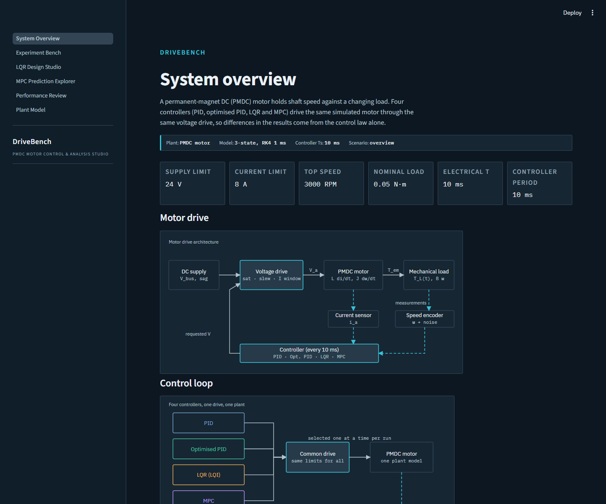
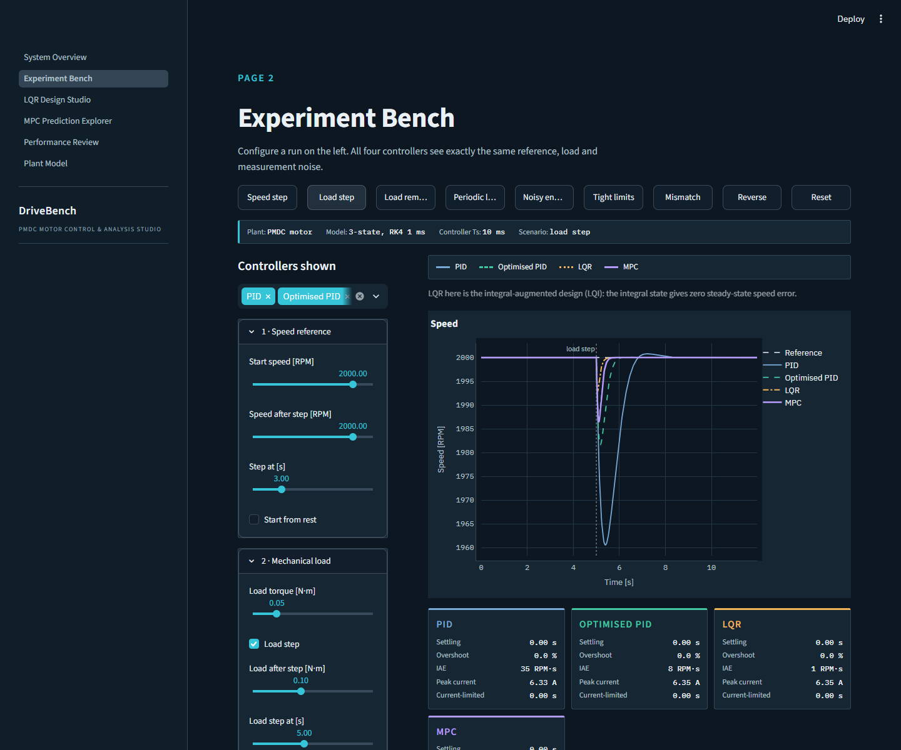
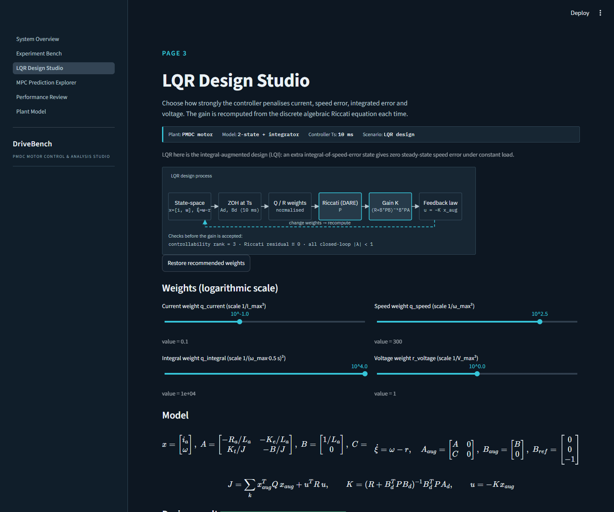
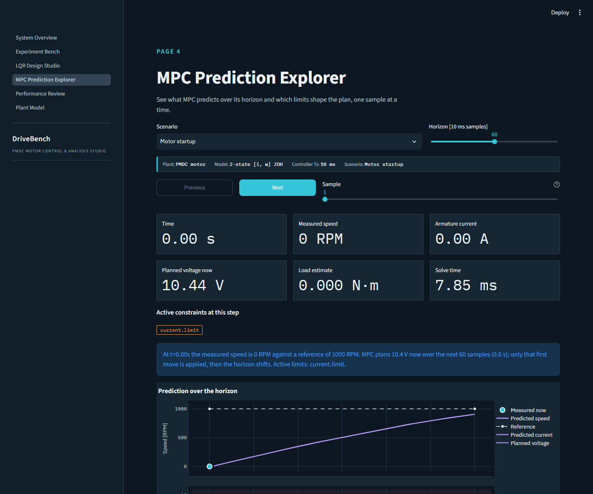
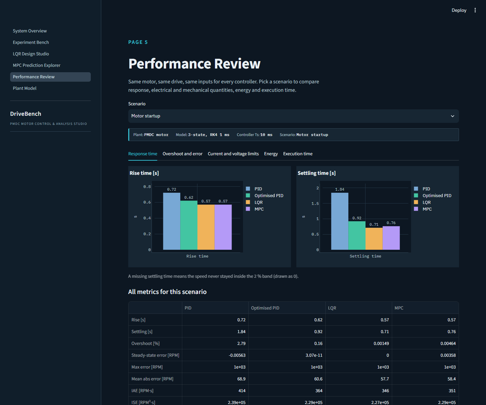
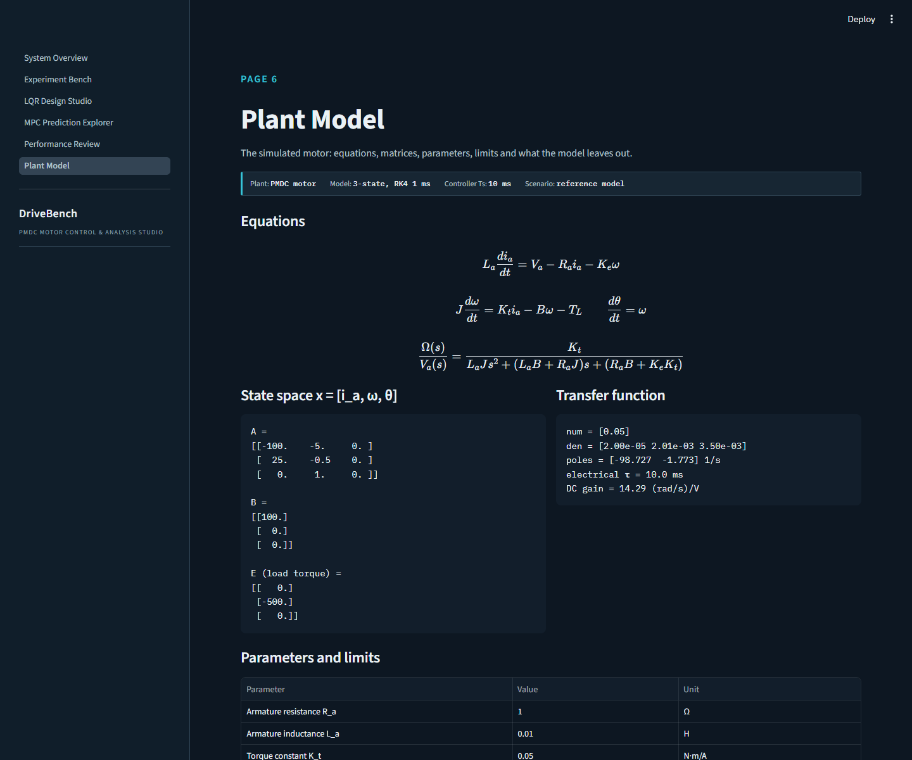
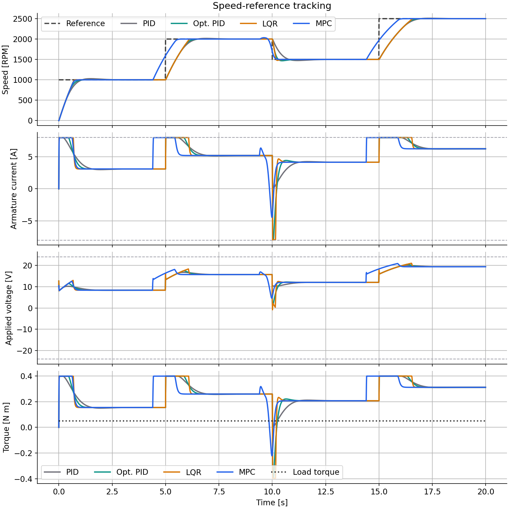
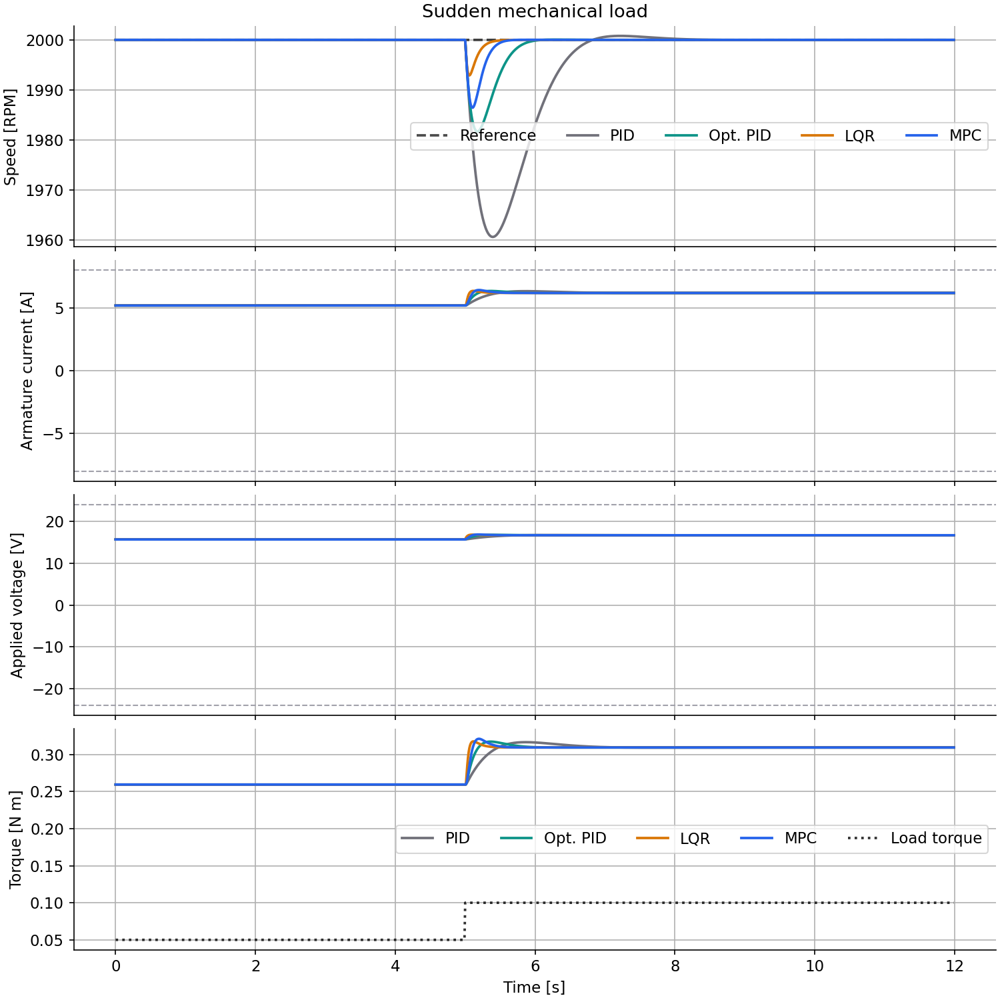
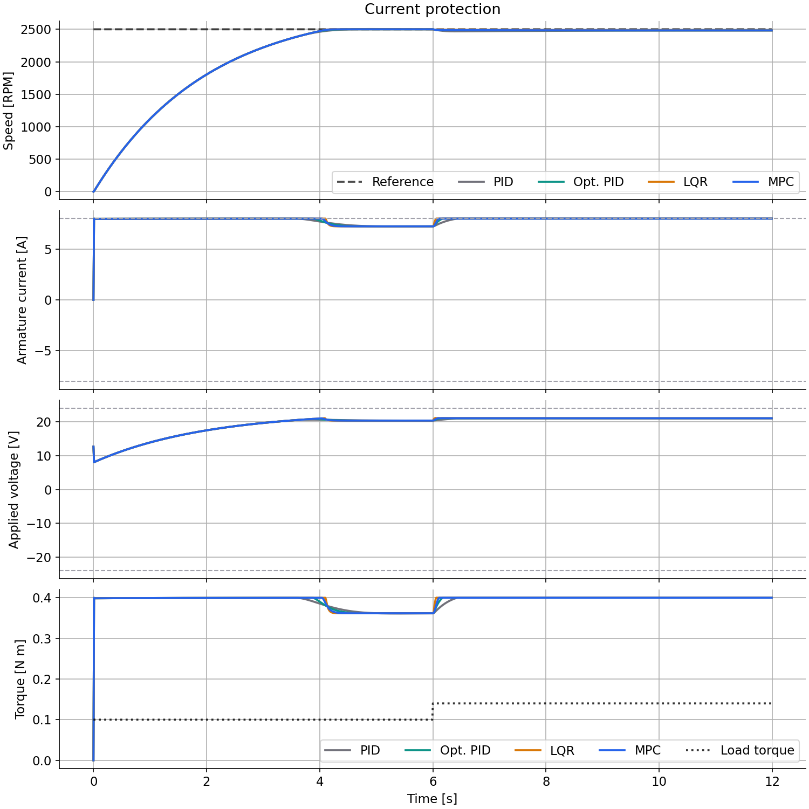

# DriveBench: PMDC Motor Control & Analysis Studio


<p align="center">
  <strong>Hand-tuned PID, optimised PID, LQR (with integral action) and offset-free MPC regulating the speed of a permanent-magnet DC motor drive.</strong>
</p>

<p align="center">
  <a href="#quick-start"><b>Quick start</b></a> ·
  <a href="#interactive-app"><b>Interactive app</b></a> ·
  <a href="#proof-batch-metrics"><b>Proof</b></a> ·
  <a href="docs/EXPLAINER.md"><b>Explainer</b></a> ·
  <a href="docs/THEORY.md"><b>Theory</b></a> ·
  <a href="docs/LQR.md"><b>LQR</b></a> ·
  <a href="HOW-IT-WORKS.md"><b>How it works</b></a> ·
  <a href="report/report.md"><b>Report</b></a>
</p>

A motor speed drive of the kind that turns conveyors, pumps and machine axes: the controller sets the armature voltage, a shared drive enforces voltage, slew and current limits, and a simulated permanent-magnet DC (PMDC) motor responds. Ten reproducible scenarios, a six-page dark Streamlit workstation with precomputed data for fast opens, a 2D shaft replay, an LQR design studio, and batch results under `results/`.

This repository began as an MPC heater lab (see [`CREDITS.md`](CREDITS.md)). The plant, drive, scenarios, metrics and UI are now the motor, and an integral-augmented LQR is the fourth controller.

## Quick start

```bash
python3 -m venv .venv && source .venv/bin/activate
pip install -r requirements.txt
pip install -e ".[dev]"
python3 -m pytest -q
python3 examples/run_simulations.py
python3 scripts/precompute_ui_data.py   # also re-tunes and freezes the optimised PID
streamlit run app.py
```

### Deploy

- **Streamlit Community Cloud** — full interactive lab. Align with
  [file organization](https://docs.streamlit.io/deploy/streamlit-community-cloud/deploy-your-app/file-organization)
  and [app dependencies](https://docs.streamlit.io/deploy/streamlit-community-cloud/deploy-your-app/app-dependencies):
  - **Main file:** `app.py` (repo root; multipage via `st.navigation` + `ui_pages/`).
  - **Dependencies:** root `requirements.txt` only (no `packages.txt`; no `-e .`).
    `app.py` adds `src/` to `sys.path` so `mpc_core` imports resolve. No new dependency was added for the motor lab.
  - **Python:** Advanced settings → **3.12** (matches `.python-version`). On 3.13/3.14,
    Cloud may build numpy/scipy/pandas from source and hang.
  - After a push, use **Reboot app** so the new entrypoint is picked up.
- **Vercel static mirror (`web/`)** is rebuilt for DriveBench: six static pages (overview, bench, LQR design, MPC explorer, performance, plant model) over the same precomputed JSON, with no build step (`vercel.json` serves `web/` as is). Regenerate its data with `python scripts/sync_web_data.py` after any `data/ui` change. It is read-only: custom motors, live LQR weights and live runs need the Streamlit app.
- **`video/`** (the showcase video project) still shows the retired heater lab and is **stale**.

## Interactive app

Dark graphite theme (`.streamlit/config.toml`, tokens in `src/mpc_core/sim/theme.py`, notes in [`DESIGN.md`](DESIGN.md)). IBM Plex fonts load from Google Fonts with system fallbacks.

1. **System Overview**: motor specifications, drive architecture and four-controller diagrams, controller summaries.
2. **Experiment Bench**: presets and a six-group configuration rail (reference, load, drive constraints, sensor, mismatch, controller settings), controller selection, a dominant speed chart with tabs for armature current, drive voltage, torque, power and energy, and requested-vs-applied voltage; controller readout tiles, a key-metrics table, a **Motor operating conditions** form with validation and restore-defaults, and the animated shaft view.
3. **LQR Design Studio**: state-space and augmented equations, logarithmic weight sliders, gain K, Q/R, Riccati solution, closed-loop poles, controllability and stability checks, and a startup response preview. Invalid designs are rejected and not used.
4. **MPC Prediction Explorer**: step through predicted speed, predicted armature current, the planned voltage sequence, and the active constraints at each sample.
5. **Performance Review**: four-controller scorecard for each scenario (response, error integrals, current and voltage limits, energy, execution time).
6. **Plant Model**: equations, transfer function, matrices, parameters, limits, assumptions and limitations.

| System Overview | Experiment Bench (load step) | LQR Design Studio |
| :---: | :---: | :---: |
|  |  |  |

| MPC Prediction Explorer | Performance Review | Plant Model |
| :---: | :---: | :---: |
|  |  |  |

Bench presets: [speed step](docs/drivebench-bench-speed-step.png), [reverse](docs/drivebench-bench-reverse.png). Regenerate all with `python scripts/capture_streamlit_screenshots.py` while the app runs on port 8501 (needs `pip install playwright` and an installed Chrome).

## Proof (batch metrics)

Real output of `scripts/rebuild_report_metrics.py` (`report/metrics_summary.json`); the same numbers as the Performance Review page. Optimised PID uses the gains found once on `speed_tracking` (Kp 0.0326 V/RPM, Ki 0.131, Kd 0) and is **not** retuned per scenario. Every controller sees the same reference, load, bus and noise arrays and goes through the same drive.

| Scenario | Metric | PID | Optimised PID | LQR | MPC |
| --- | --- | --- | --- | --- | --- |
| Motor startup (0→1000 RPM) | Settling [s] | 1.84 | 0.92 | **0.71** | 0.76 |
| Speed tracking (4 steps) | IAE [RPM·s] | 1854 | 1660 | 1608 | **1071** |
| Load step (0.05→0.10 N·m) | IAE [RPM·s] | 35 | 8 | **1.2** | 3.2 |
| Variable load | IAE [RPM·s] | 275 | 96 | **18** | 45 |
| Sensor noise (15 RPM σ) | IAE [RPM·s] | 181 | 160 | 173 | **103** |
| Reverse (±1000 RPM) | Settling [s] | 2.37 | 1.44 | 1.24 | **0.69** |
| Voltage saturation (bus sag) | IAE [RPM·s] | 4122 | 4092 | 4072 | **3307** |
| Current protection | Time current-limited [s] | 9.18 | 9.71 | 10.05 | **4.34** |
| Model mismatch (R +20 %, J +30 %, B +25 %) | IAE [RPM·s] | 1794 | 1700 | 1676 | **1290** |

Read these with the caveats in mind:

- The MPC and LQR know the nominal motor model and use the measured armature current; the PID loops use speed only. That is the point of the comparison, not a like-for-like feedback structure.
- The LQR weights (`q_current=0.1, q_speed=300, q_integral=10000, r_voltage=1`) and the MPC settings were set by hand while looking at these scenarios, so neither is a neutral tuning contest.
- LQR rejects load steps best of the four here (it feeds back current and has an integrator), but it spends the longest in the current limit because it does not plan around it; MPC plans along the limit and runs a numerical optimisation (about 3–6 ms per sample against about 0.01 ms for the others).
- The load-step and load-removal differences are mostly the MPC's disturbance estimator reacting within a sample or two. A PID with a larger integral gain would close part of the gap to MPC, at the price of noise sensitivity and overshoot (see the noise scenario).
- Where the drive's limits dominate (`voltage_saturation`, `current_protection`) the controllers are close, because the actuator, not the algorithm, sets the best achievable response.
- The weights, horizon and observer gain are hand-set; no stability proof is claimed. Parameters are illustrative.
- Under ±20 % winding-resistance error the drive's current limit can be exceeded transiently (peak 9.1 A against an 8 A limit in the low-resistance corner) before feedback backs the voltage off.

All metrics (rise time, steady-state error, ITAE, RMS current, energy, motor and drive efficiency, recovery time, …) are in `results/metrics_summary.json` and `results/<scenario>_metrics.md`. Per-scenario figures are `results/<scenario>.png`.

| Speed tracking | Load step | Current protection |
| :---: | :---: | :---: |
|  |  |  |

## How it works

```text
 encoder (+noise) ──┐
 current sensor ────┼─► offset-free MPC (SciPy SLSQP, [i, ω] model + torque/voltage estimates)
                    ├─► LQR with integral action (DARE gain, Ts = 10 ms)
                    │           │ V_cmd                 PID / optimised PID ◄─ speed
                    ▼           ▼                              │
              ┌──────────────── motor drive ◄──────────────────┘
              │   enable · slew limit · ±V_max · current protection
              ▼ V_a
        PMDC motor twin  (L di/dt, J dω/dt, RK4 at 1 ms; controller every 10 ms)
```

Plain story: [`docs/EXPLAINER.md`](docs/EXPLAINER.md) · Maths and modelling: [`docs/THEORY.md`](docs/THEORY.md) · Engineering notes: [`HOW-IT-WORKS.md`](HOW-IT-WORKS.md) · Course write-up: [`report/drivebench_report.pdf`](report/drivebench_report.pdf) · source [`report/drivebench_report.tex`](report/drivebench_report.tex) · notes [`report/README.md`](report/README.md)

The actual plant, the MPC's prediction model, the drive and the measurement model are four separate pieces of code; `docs/THEORY.md` §5 maps them.

Educational use. Licences: [`CREDITS.md`](CREDITS.md).
